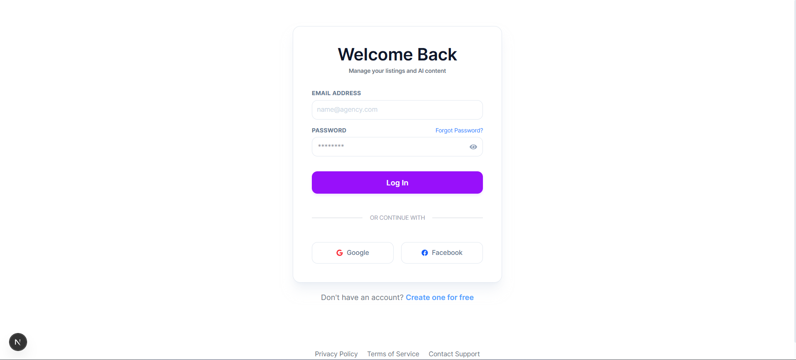
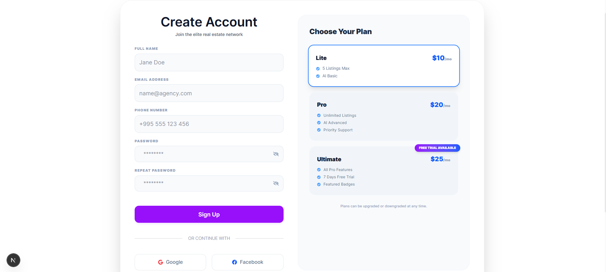
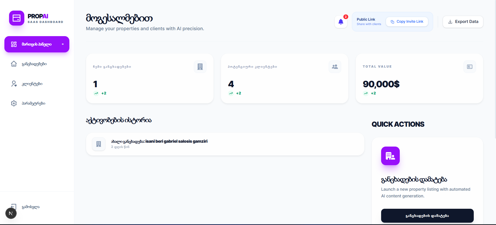
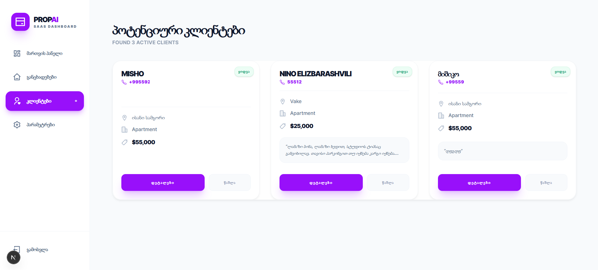
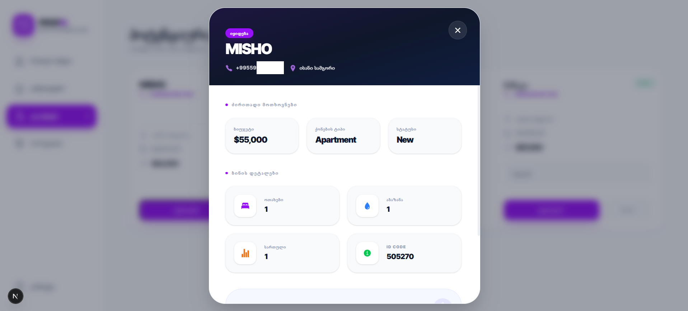
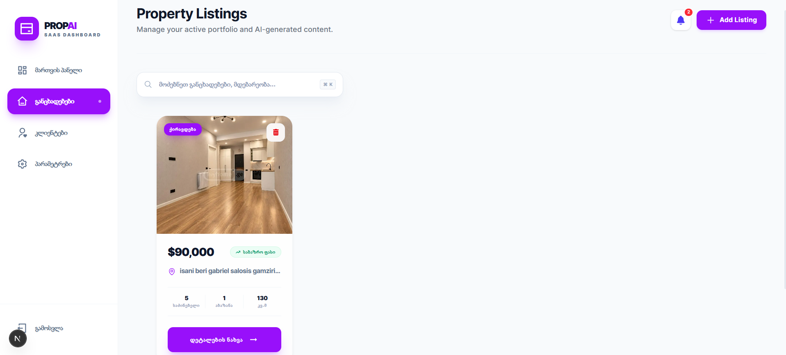
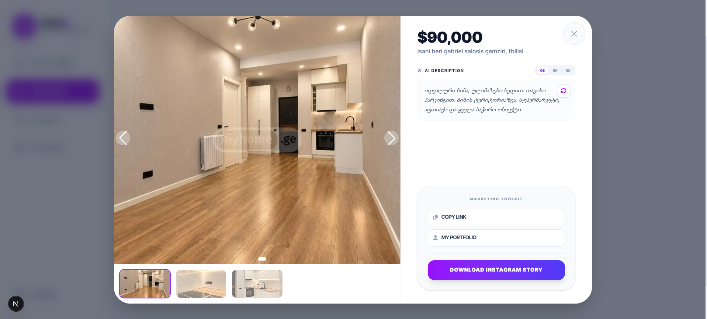
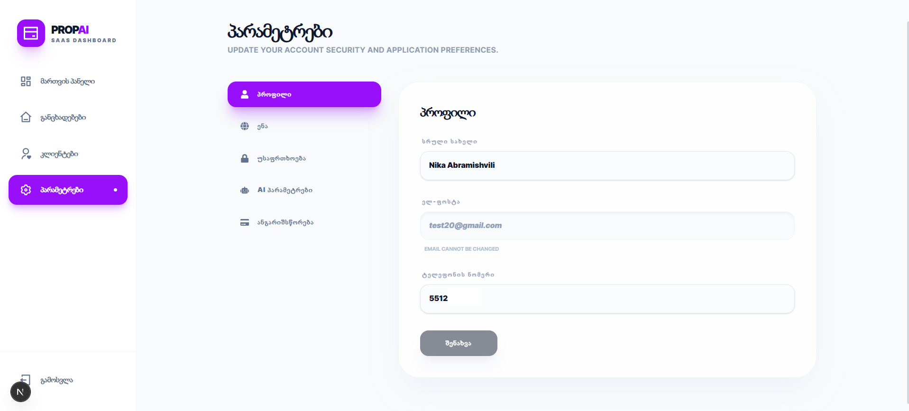
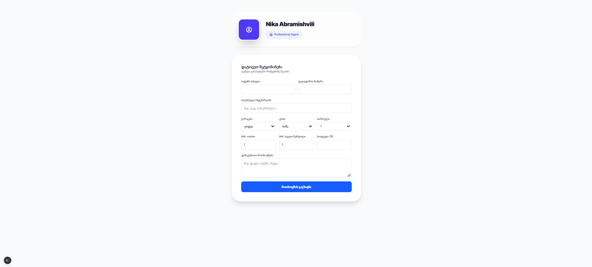

# PropAI — Real Estate Management SaaS

PropAI is a SaaS dashboard for real estate agents to manage property listings, track buyer leads, and generate AI-assisted listing descriptions. It is built with **Next.js (App Router)**, **TypeScript**, **PostgreSQL** and **Prisma**.

## Project Overview

Independent agents typically juggle listings, client requirements and marketing copy across spreadsheets and chat apps. PropAI consolidates these workflows into one dashboard:

- Agents publish property listings with images and details.
- Agents share a public profile and contact form. Submissions become buyer leads and in-app notifications.
- Agents rewrite listing descriptions with an AI service in multiple languages, subject to a per-plan daily quota.

## Live Demo & Links

- **Live demo:** [propai.vercel.app](https://propai.vercel.app/)
- **GitHub repository:** [github.com/MishSoft/propai](https://github.com/MishSoft/propai)

## Key Features

- **Account access:** email and password sign-in, optional Google and Facebook sign-in, and registration.
- **Dashboard:** portfolio statistics, recent activity, quick actions, and profile, language, security and AI settings.
- **Property listings:** create, edit, view and delete listings with image uploads, search and filtering.
- **Buyer leads:** review potential clients, open buyer details, and remove leads.
- **Public agent page:** a shareable agent profile with a contact form. Each submission creates a lead and a notification.
- **Notifications:** in-app notification center with mark-as-done.
- **AI listing descriptions:** rewrites listing text into professional descriptions in the requested languages, with a configurable writing tone and daily usage limits by plan.
- **Multilingual interface:** English, Georgian and Russian.

## Screenshots

All screenshots are located in [`docs/screenshots/`](docs/screenshots/).

### Login


### Registration


### Dashboard Overview


### Potential Clients


### Buyer Details


### Property Listings


### Listing Details and AI Description


### Settings


### Public Agent Contact Form


## Tech Stack

| Layer | Technologies |
|---|---|
| Frontend | Next.js 16 (App Router), React 19, TypeScript, Tailwind CSS 4, Zustand, Swiper, react-icons, next-themes |
| Backend | Next.js Route Handlers, Zod, bcrypt, Groq API (AI rewrite), `@next-auth/prisma-adapter` |
| Database | PostgreSQL, Prisma ORM 7 with `@prisma/adapter-pg` and `pg` |
| Authentication | NextAuth.js 4 (credentials, optional Google and Facebook OAuth), JWT session strategy |
| Media & i18n | Cloudinary (`next-cloudinary`), `next-intl` |
| Tooling | Biome (lint/format), Prisma CLI, `tsx` |
| Deployment | Vercel (production deployment at [propai.vercel.app](https://propai.vercel.app/)) |

## Architecture & Engineering Highlights

- **Next.js App Router with route handlers.** Backend endpoints live in `app/api/**/route.ts`, and pages in `app/**/page.tsx`.
- **Prisma with the PostgreSQL driver adapter.** `lib/db.ts` creates a `pg` connection pool and passes it to `PrismaClient` through `PrismaPg`. The Prisma client is cached on the global object outside production to avoid multiple instances during development hot reloads.
- **Centralized authentication configuration.** `lib/auth.ts` is the single NextAuth configuration used by the route handler and server-side session lookups. OAuth providers are registered only when their credentials exist in the environment.
- **Absolute session lifetime.** The auth time is set at sign-in and never refreshed, so the 24-hour limit cannot be extended by activity (`lib/auth.ts`, `lib/session-policy.ts`).
- **Atomic lead capture.** The public contact endpoint writes the buyer and its notification in one `prisma.$transaction` (`app/api/agent/[id]/contact/route.ts`).
- **Plan-based AI quotas.** Usage is checked and incremented per user with a daily UTC reset (`lib/ai-limits.ts`).
- **Shared validation.** Contact form input is validated with a Zod schema in `lib/validations/contact.schema.ts`.
- **Environment validation.** `lib/env-check.ts` checks required variables at startup. It throws in production and only warns in development.
- **Schema migrations.** Prisma migrations are versioned under `prisma/migrations/`.

## Getting Started

### Prerequisites

- Node.js 20 or later
- npm (a `package-lock.json` is included)
- A PostgreSQL database

### 1. Install dependencies

```bash
npm install
```

### 2. Configure environment variables

Create a `.env` file in the project root. **Do not commit it.** The variables below are the names read by the code; values must come from your own environment.

| Variable | Required | Purpose |
|---|---|---|
| `DATABASE_URL` | Yes | PostgreSQL connection string (used by `lib/db.ts` and `prisma.config.ts`) |
| `NEXTAUTH_URL` | Yes | Public base URL of the app, used by NextAuth |
| `NEXTAUTH_SECRET` | Yes | Secret used by NextAuth to sign and encrypt tokens |
| `GOOGLE_CLIENT_ID` / `GOOGLE_CLIENT_SECRET` | No | Enables Google sign-in when both are set |
| `FACEBOOK_CLIENT_ID` / `FACEBOOK_CLIENT_SECRET` | No | Enables Facebook sign-in when both are set |
| `GROQ_API_KEY` | No | Required only for the AI description rewrite feature |

Image uploads use Cloudinary through `next-cloudinary` with an unsigned upload preset configured in your Cloudinary account.

### 3. Set up the database with Prisma

```bash
npx prisma migrate deploy   # apply existing migrations
npx prisma generate         # generate the Prisma client
```

For local schema development, use `npx prisma migrate dev` instead. Prisma Studio is available with `npx prisma studio`.

### 4. Run the development server

```bash
npm run dev
```

Open [http://localhost:3000](http://localhost:3000).

### Other scripts

| Command | Description |
|---|---|
| `npm run build` | Runs `prisma generate` and `next build` |
| `npm run start` | Starts the production server (requires a prior build) |
| `npm run lint` | Runs Biome checks |
| `npm run format` | Formats code with Biome |

## Limitations & Roadmap

### Current Limitations

- Notifications are delivered by polling every 15 seconds. WebSockets, server-sent events and push notifications are not implemented.
- API requests are not rate limited.
- Plan selection is displayed during registration, but payment processing is not implemented.
- The project has no automated test suite.

### Planned Improvements

These items are planned and are not yet implemented:

- **API Rate Limiting:** request limits on authentication and AI endpoints.
- **Spam Protection:** safeguards on the public agent contact form.
- **Advanced Buyer Management:** richer lead filtering, status workflows and follow-up tracking.
- **UI/UX Improvements:** refinements to dashboard layout, responsiveness and usability.
- **Automated Testing:** unit and integration test coverage for API routes and core logic.

## Author / Portfolio

- **GitHub:** [github.com/MishSoft](https://github.com/MishSoft)
- **Repository:** [github.com/MishSoft/propai](https://github.com/MishSoft/propai)
